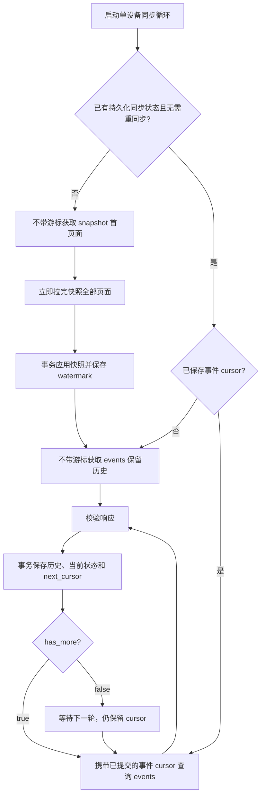

# 业务后端接入报警轮询：逐步说明与示例

依据当前工作区实现编写，日期：2026-11-06。面向负责调用工控机接口、存储报警、展示状态和发送通知的业务后端开发人员。

本文中的数据、ID、时间和游标都是教学示例。`E6`、`E8`、`S6-P2` 是方便说明的**游标别名**，不能用于实际接口；真实接入必须保存并传回服务端给出的完整字符串，不自行生成或解析。

## 先理解整个流程

后端要分别维护三件事：

1. **事件历史**：发生过什么，例如相机失败、再次失败、恢复、某次任务失败。
2. **当前报警状态**：哪些持续性故障现在仍未恢复。
3. **同步状态**：已经可靠保存到哪个游标，最后一次查询及入库是否成功。

`GET /api/alarms` 是只读接口。轮询、保存游标和人工确认都不清除工控机报警，也不复位设备或控制生产。



前面讨论的“只有第一次不带游标，后续都带”指的是 **events 正常增量同步**。完整首次接入还要先做一次 snapshot：snapshot 首页面和 events 首页面都不带游标；两种模式的分页游标不能混用。断点恢复、事件保留期过期等异常见步骤 10、11。

## 步骤 1：配置设备与请求方式

每台设备配置服务地址、预期设备标识和只读凭据。使用服务地址对应的工控机，不要把不同设备返回的数据写入同一套消费位置。

建议配置如下。这是**业务后端配置示例，不是接口请求体**：

```json
{
  "base_url": "https://colony-device.example.internal",
  "expected_device_id": "device-001",
  "token_secret_reference": "设备凭据在后端秘密管理中的引用",
  "poll_interval_seconds": 5,
  "request_timeout_seconds": 3,
  "page_size": 100
}
```

请求方式：

```http
GET /api/alarms?mode=events&limit=100
Authorization: Bearer <服务端配置的 COLONY_ALARM_TOKEN>
Accept: application/json
```

| 请求参数 | 怎么使用 |
| --- | --- |
| `mode` | `snapshot` 获取当前活动报警快照；`events` 获取事件增量，默认 events |
| `cursor` | 对应模式上次返回的 `next_cursor`；首次请求省略整个参数 |
| `limit` | 每页条数，默认 100，允许 1～500 |

没有 JSON 请求体，没有 `cursor_id` 参数，也不支持 `category=camera` 等服务端筛选。先同步所有类型，再在后端查询自己的数据库进行筛选。

使用 HTTP 客户端的查询参数功能进行 URL 编码。例如 Python 标准库的构造方式：

```python
from urllib.parse import urlencode

saved_cursor = "<数据库中已提交的真实游标>"
params = {"mode": "events", "limit": 100}
if saved_cursor is not None:
    params["cursor"] = saved_cursor
url = "https://colony-device.example.internal/api/alarms?" + urlencode(params)
```

每台设备运行一个不重叠的同步循环。多实例部署时，使用现有调度分片或数据库锁保证同一设备只有一个实例推进游标。不同设备可以并行。

## 步骤 2：准备后端保存的数据

下表是建议的逻辑结构，表名可按你的后端规范调整。现有 Python 参考实现对应 `events`、`alarm_state`、`metadata`、`history_gaps` 四类数据；人工确认及通知发件箱需要业务后端自行实现。

| 数据 | 建议唯一键 | 保存内容与用途 |
| --- | --- | --- |
| `alarm_events` | `(device_id, stream_id, event_id)`，另保证同设备同流 sequence 唯一 | 完整事件 JSON；保存不可变历史并去重 |
| `alarm_current` | `(device_id, stream_id, alarm_id)` | 每个报警最后应用的 sequence、active、count、完整记录；用于当前状态展示 |
| `alarm_sync_state` | `device_id` | stream_id、boot_id、事件游标、最近已提交事件序号、快照 watermark、同步阶段、成功时间、错误、monitoring |
| `alarm_sync_gaps` | 后端生成的记录 ID | 何时因保留期、流变化等无法保证历史连续 |
| `alarm_acknowledgements` | 设备、流、报警及确认版本 | 确认人、时间、备注；与设备 active 状态分开 |
| `notification_outbox` | 设备、流、事件 ID、通知渠道等幂等键 | 待发送通知；事务提交后由通知任务发送，避免重复或漏发 |

其中 `alarm_current` 可以保留 active=false 的最后状态；展示“当前未恢复报警”时查询 active=true。`recorded` 类型可只入历史，也可以像参考实现一样保存为非活动状态行，不能把它当作曾经活动后恢复。

首次运行时的同步状态示例，字段名是**业务后端自定义字段**：

```json
{
  "device_id": "device-001",
  "stream_id": null,
  "boot_id": null,
  "initialized": false,
  "phase": "snapshot",
  "event_cursor": null,
  "last_event_sequence": null,
  "snapshot_watermark": null,
  "resync_required": false,
  "last_valid_response_at": null,
  "last_page_committed_at": null,
  "last_error": null
}
```

`event_cursor` 是后端字段；发送 HTTP 时参数名仍是 `cursor`。`last_event_sequence` 保存本轮同步最后一条已提交事件的序号，仅用于校验，不能替代游标。快照临时分页游标另存，不能覆盖事件游标。也不要把游标仅放在内存或短期缓存里，否则后端重启就失去断点。

## 步骤 3：认识响应字段并完成校验

### 3.1 页面字段怎么处理

| 响应字段 | 含义 | 后端动作 |
| --- | --- | --- |
| `protocol_version` | 当前为整数 1 | 校验支持该版本，否则保留旧游标并报告契约错误 |
| `device_id` | 稳定设备标识 | 与配置/已绑定身份核对，不能接收另一设备的数据 |
| `stream_id` | 持久化事件流身份 | 保存；改变时重新同步，不能跨流比较 sequence |
| `boot_id` | 本次 API 进程启动标识 | 保存用于诊断；只变 boot_id 不等于数据库重建或硬件恢复 |
| `mode` | 本次查询模式 | 核对请求模式；按快照或事件的规则处理 |
| `items` | 本页事件或活动状态记录 | 校验后保存，不能仅凭数组为空清空当前报警 |
| `next_cursor` | 后续页面/轮询位置 | 成功保存本页后持久化；events 模式空页也有有效值 |
| `has_more` | 当前是否还有待取页面 | true 立即请求下一页，false 等下一轮；不是“设备有无报警” |
| `watermark` | 查询时的事件流上界；快照中是冻结上界 | 快照值持久化用于历史回放保护；不能拿它当事件页已消费位置 |
| `retention_start_sequence` | 当前仍可读取的历史起点 | 检查历史保留范围及快照到回放之间是否出现缺口 |
| `events_cursor` | snapshot 上界对应的事件游标，仅快照模式提供 | 验证快照各页一致；完整首次接入仍回放历史，不直接从它起步 |
| `snapshot_expires_at` | 快照过期时间，仅快照模式提供 | 超期/收到 snapshot_expired 时重新取整份快照 |
| `monitoring` | 记录器、监测线程、任务线程、磁盘等摘要 | 每个有效响应都刷新，即使 items 为空 |

**watermark 不是本页最后一条。** 例如下面的页面只返回了 1～3，必须继续用 E3，不能跳到 E6：

```json
{
  "mode": "events",
  "watermark": 6,
  "items": [
    {"sequence": 1},
    {"sequence": 2},
    {"sequence": 3}
  ],
  "has_more": true,
  "next_cursor": "E3"
}
```

上面是字段摘录，不是完整响应。events 每一页的 watermark 可以随着新事件产生而增加；只有同一份 snapshot 的 watermark 固定。API 没有公开的 `last_sequence` 字段。

### 3.2 单条记录怎么处理

| 记录字段 | 后端处理 |
| --- | --- |
| `event_id` | 历史事件去重键的一部分；当作不透明标识，不拆分格式 |
| `sequence` | 同一 stream 内的事件顺序；用于防止旧状态覆盖新状态 |
| `alarm_id` | 同一轮持续故障的关联标识；更新/恢复该报警，不影响其他报警 |
| `category` | 分类展示，如 camera、motion、storage；接受未来新增分类 |
| `code` | 稳定故障代码；按代码配置展示规则，未知新代码仍完整保存 |
| `severity` | P0、P1、P2、INFO；决定展示和通知优先级，不直接触发设备控制 |
| `message` | 服务端公开文案；展示即可，不从文案推断 active 状态 |
| `component` / `resource` | 故障来源和具体资源；resource 可能是文件路径摘要，不一定可直接当名称展示 |
| `transition` | occurred、updated、recovered、recorded；按步骤 6～8 处理 |
| `active` | 是否是尚未恢复的持续性报警；false 不一定代表曾经故障后恢复 |
| `count` | 本轮故障累计上报次数；保存服务端值，不在每次轮询时自行加 1 |
| `first_occurred_at` | 本轮故障首次发生时间 |
| `occurred_at` | 当前事件发生时间，也可能是本次更新/恢复时间 |
| `recorded_at` | 当前事件写入工控机报警数据库的时间；补录历史时可能晚于 occurred_at |
| `task_id` / `execution_id` | 关联任务和这一次执行，可能为 null；相同 task_id 可有多次 execution |
| `diagnostic_id` | 本地日志诊断标识，保存用于定位，不是事件去重键 |

时间按带时区的值保存，展示时转为用户时区。例如 `2026-11-06T02:00:00+00:00` 对应台北时间 10:00。消费顺序使用 sequence，不按时间戳排序，因为补录或系统时钟调整可能造成时间不递增。

校验示例：

- `code="FUTURE_DEVICE_ERROR"`，其他字段合法：保存原 code，使用通用样式展示，不丢整页。
- `severity="P9"`、不支持的 transition 或 protocol_version：视为契约错误，整页不提交，不推进事件游标。
- 相同 event_id 或相同 sequence 已存在但内容不同：报告数据冲突，不静默覆盖历史。
- events 页内 sequence 应严格递增，记录不得超过 watermark；snapshot 不保证按 sequence 排序。
- 对当前消费位置，有记录的 events 页首条 sequence 必须大于 last_event_sequence，watermark 不得小于 last_event_sequence；有记录时 next_cursor 也不能等于本次请求使用的 cursor。否则视为异常页面，不继续循环或推进位置。
- has_more=true 时 items 不能为空，next_cursor 必须是非空字符串；快照分页不能重复使用已经走过的游标。
- `occurred/updated` 应对应 active=true，`recovered/recorded` 应对应 active=false。

重新同步并成功应用新快照时，事件游标和 last_event_sequence 都要重置，以便重新回放历史；上述校验不能使用历史表的最大 sequence，否则合法的重放也会被误判为倒退。

以下步骤用同一组事件贯穿解释。

| sequence | 报警别名 | code | transition | active | count |
| --- | --- | --- | --- | --- | --- |
| 1 | A | CAMERA_SDK_ERROR | occurred | true | 1 |
| 2 | A | CAMERA_SDK_ERROR | updated | true | 2 |
| 3 | T | TASK_FAILED | recorded | false | 1 |
| 4 | A | CAMERA_SDK_ERROR | recovered | false | 2 |
| 5 | B | DISK_SPACE_LOW | occurred | true | 1 |
| 6 | C | CAMERA_SDK_ERROR | occurred | true | 1 |

A 已经恢复，C 是后来再次发生的相机故障，使用新 alarm_id。此刻设备当前有 B、C 两个活动报警。

## 步骤 4：首次接入，拉完当前报警快照

### 4.1 请求快照首页面

实际通常使用 limit=100；这里使用 limit=1 演示分页：

```http
GET /api/alarms?mode=snapshot&limit=1
Authorization: Bearer <token>
```

假设第一页面返回 B。下面展示完整响应结构，示例值已替换：

```json
{
  "protocol_version": 1,
  "device_id": "device-001",
  "stream_id": "stream-001",
  "boot_id": "boot-001",
  "mode": "snapshot",
  "retention_start_sequence": 1,
  "watermark": 6,
  "items": [
    {
      "event_id": "event-005",
      "alarm_id": "alarm-B",
      "sequence": 5,
      "category": "storage",
      "code": "DISK_SPACE_LOW",
      "severity": "P2",
      "message": "存储可用空间不足，请及时清理或扩容",
      "component": "storage",
      "resource": "default",
      "task_id": null,
      "execution_id": null,
      "diagnostic_id": "diagnostic-B",
      "active": true,
      "transition": "occurred",
      "count": 1,
      "first_occurred_at": "2026-11-06T02:00:05+00:00",
      "occurred_at": "2026-11-06T02:00:05+00:00",
      "recorded_at": "2026-11-06T02:00:05+00:00"
    }
  ],
  "has_more": true,
  "next_cursor": "S6-P2",
  "snapshot_expires_at": "2026-11-06T02:10:10+00:00",
  "events_cursor": "E6",
  "monitoring": {
    "store": {"status": "healthy", "recording_gap_possible": false},
    "monitor": {"status": "healthy", "sampled_at": "2026-11-06T02:00:10+00:00", "age_seconds": 0.2},
    "task_worker": {
      "status": "healthy", "worker_alive": true, "accepting": true,
      "queue_size": 0, "sampled_at": "2026-11-06T02:00:10+00:00"
    },
    "disk": {
      "status": "warning", "free_percent": 15.0,
      "warning_percent": 20.0, "critical_percent": 10.0, "thresholds_defaulted": false
    },
    "hardware": {"status": "unknown", "reason": "no_active_hardware_probe"}
  }
}
```

后端动作：校验设备与字段，暂存 B；因为 has_more=true，立即继续。**此时不要清空或替换当前报警表**，否则下一页失败会丢掉已知状态。monitoring 可以先更新为最新有效响应摘要。

### 4.2 请求快照下一页

```http
GET /api/alarms?mode=snapshot&limit=1&cursor=S6-P2
Authorization: Bearer <token>
```

响应字段摘录：

```json
{
  "device_id": "device-001",
  "stream_id": "stream-001",
  "mode": "snapshot",
  "watermark": 6,
  "items": [
    {
      "event_id": "event-006", "alarm_id": "alarm-C", "sequence": 6,
      "code": "CAMERA_SDK_ERROR", "transition": "occurred", "active": true, "count": 1
    }
  ],
  "has_more": false,
  "next_cursor": null,
  "events_cursor": "E6"
}
```

检查整份快照的 device_id、stream_id、watermark、events_cursor 一致；报警 ID 不能重复，分页游标不能循环。monitoring 是各次请求读取的缓存摘要，可以随页面变化，不要求一致。

### 4.3 全部页面成功后，一次性应用快照

在一个数据库事务中应用 B、C，同时保存快照上界 W=6 和初始化状态。应用后：

| alarm_current | 最新 sequence | active | count |
| --- | --- | --- | --- |
| B | 5 | true | 1 |
| C | 6 | true | 1 |

```json
{
  "device_id": "device-001",
  "stream_id": "stream-001",
  "boot_id": "boot-001",
  "initialized": true,
  "phase": "history_replay",
  "snapshot_watermark": 6,
  "event_cursor": null,
  "last_event_sequence": null,
  "resync_required": false
}
```

此时 event_cursor 仍为空，因为下一步要回放保留历史；**不要把 E6 直接设为已消费位置**。

重新同步时若已经有旧状态：同一个 stream 内只替换 sequence≤W 的状态，保留 sequence>W 的更新；若 stream 改变，完整新快照成功后切换当前状态所属流，保留旧历史。快照中缺席的旧报警可标记为“快照校准后不再活动”，但不要伪造一条设备 recovered 事件或恢复时间。

如果第 2 页失败，丢弃这次未完成的快照暂存数据，后续重取整份；当前报警保持原样。快照最长有效 10 分钟，服务重启或缓存淘汰也可能使它提前失效。

## 步骤 5：回放保留历史，补齐快照看不到的事件

### 5.1 从最早保留历史开始

```http
GET /api/alarms?mode=events&limit=3
Authorization: Bearer <token>
```

这里不带 cursor。否则如果直接用 E6，会漏掉 A 的发生、重复和恢复，以及 T 的任务失败历史。

第 1 页响应摘录：

```json
{
  "mode": "events",
  "stream_id": "stream-001",
  "watermark": 6,
  "retention_start_sequence": 1,
  "items": [
    {"event_id": "event-001", "alarm_id": "alarm-A", "sequence": 1, "transition": "occurred", "active": true, "count": 1},
    {"event_id": "event-002", "alarm_id": "alarm-A", "sequence": 2, "transition": "updated", "active": true, "count": 2},
    {"event_id": "event-003", "alarm_id": "alarm-T", "sequence": 3, "transition": "recorded", "active": false, "count": 1}
  ],
  "has_more": true,
  "next_cursor": "E3"
}
```

后端处理：

1. 校验 stream 与当前快照一致。
2. 首次无游标回放时，检查 `retention_start_sequence <= snapshot_watermark + 1`。本例 `1 <= 7`，可以继续。
3. 在同一事务里保存事件 1、2、3，按事件 ID 去重，并保存 event_cursor=E3。
4. 这些事件 sequence≤6，**只写历史，不覆盖快照建立的当前状态**，否则旧事件可能把已恢复的 A 再次显示成活动报警。
5. has_more=true，立即继续。

事务提交后：历史有 1、2、3；活动报警仍是 B、C；已提交游标为 E3。

### 5.2 拉完剩余历史

```http
GET /api/alarms?mode=events&limit=3&cursor=E3
Authorization: Bearer <token>
```

第 2 页响应摘录：

```json
{
  "mode": "events",
  "stream_id": "stream-001",
  "watermark": 6,
  "retention_start_sequence": 1,
  "items": [
    {"event_id": "event-004", "alarm_id": "alarm-A", "sequence": 4, "transition": "recovered", "active": false, "count": 2},
    {"event_id": "event-005", "alarm_id": "alarm-B", "sequence": 5, "transition": "occurred", "active": true, "count": 1},
    {"event_id": "event-006", "alarm_id": "alarm-C", "sequence": 6, "transition": "occurred", "active": true, "count": 1}
  ],
  "has_more": false,
  "next_cursor": "E6"
}
```

同样只追加历史并提交游标。此时历史完整保存 1～6，活动状态仍是 B、C；保存 event_cursor=E6，进入正常轮询。

设备历史默认保留 30 天，回放无法补齐保留期之外的历史。首次接入时记录可用历史起点；以后由后端自己的数据保留规则管理已入库历史。

如果首回放时 `retention_start_sequence > W+1`，不能继续相信旧快照。例如 W=6，但回来时历史起点已是 9，7、8 中可能包含 B/C 的恢复事件。记录历史缺口，重新取完整快照再回放。这个检查依赖持久化的 W，必须能覆盖“快照提交后后端重启或长时间离线”的情况。

## 步骤 6：正常轮询，处理新发生或重复报警

假设随后 C 再次发生，同时一次新的任务 U 失败，生成事件 7、8。

```http
GET /api/alarms?mode=events&limit=100&cursor=E6
Authorization: Bearer <token>
```

响应摘录：

```json
{
  "mode": "events",
  "stream_id": "stream-001",
  "watermark": 8,
  "items": [
    {
      "event_id": "event-007", "alarm_id": "alarm-C", "sequence": 7,
      "category": "camera", "code": "CAMERA_SDK_ERROR", "severity": "P1",
      "transition": "updated", "active": true, "count": 2
    },
    {
      "event_id": "event-008", "alarm_id": "alarm-U", "sequence": 8,
      "category": "task", "code": "TASK_FAILED", "severity": "P1",
      "transition": "recorded", "active": false, "count": 1,
      "task_id": "task-002", "execution_id": "execution-002"
    }
  ],
  "has_more": false,
  "next_cursor": "E8"
}
```

后端在同一事务中：

1. 将事件 7、8 写入历史。
2. 因为 7>W=6，且比 C 已存的 sequence=6 新，更新 C：sequence=7、active=true、count=2。
3. 事件 8 是任务失败事实，写入历史和故障记录；不加入活动故障列表。它是 P1，仍应进入业务故障通知/待处理列表，不能仅通知 active=true 的事件。
4. 保存 event_cursor=E8。需要通知时，同时幂等写入通知发件箱，事务提交后再发送。

处理后的示例：

| 后端数据 | 内容 |
| --- | --- |
| 历史事件 | 1～8 |
| 当前活动报警 | B（count=1）、C（count=2） |
| 新任务失败事实 | U，关联 task-002 / execution-002 |
| 事件游标 | E8 |

四种 transition 的统一处理规则：

| transition | 写历史 | 更新当前状态 | 通知建议 |
| --- | --- | --- | --- |
| `occurred` | 是 | 对应 alarm_id 设为活动 | 按级别发送首次通知 |
| `updated` | 是 | 更新同一 alarm_id 的计数、最新字段 | 按重复次数/时间窗口限频，避免每次重复都刷屏 |
| `recovered` | 是 | 对应 alarm_id 设为非活动 | 可发送恢复通知；不影响其他报警 |
| `recorded` | 是 | 不作为活动故障 | P0/P1/P2 按业务关注；INFO 通常只入历史 |

表中的状态更新都须满足 sequence>snapshot_watermark，且比该 alarm_id 已存的版本新。不得用旧历史倒退当前状态。

## 步骤 7：没有新事件时，仍然带游标继续轮询

```http
GET /api/alarms?mode=events&limit=100&cursor=E8
Authorization: Bearer <token>
```

响应摘录：

```json
{
  "mode": "events",
  "stream_id": "stream-001",
  "watermark": 8,
  "items": [],
  "has_more": false,
  "next_cursor": "E8",
  "monitoring": {
    "store": {"status": "healthy", "recording_gap_possible": false},
    "monitor": {"status": "healthy", "sampled_at": "2026-11-06T02:00:20+00:00", "age_seconds": 0.3},
    "hardware": {"status": "unknown", "reason": "no_active_hardware_probe"}
  }
}
```

后端动作：保持 B、C 活动状态不变；刷新 monitoring 和有效响应时间；成功提交本页的 next_cursor=E8；等待下一轮后继续携带 E8。

这里游标没有变化是正常的：没有新事件，消费位置也没有前进。不要因此判定接口卡住，也不要为了“换一个游标”去掉 cursor。

| 容易混淆的值 | 正确含义 |
| --- | --- |
| items=[] | 本次没有新增事件，不代表没有旧报警 |
| has_more=false | 当前没有更多分页，下一轮仍要带游标 |
| count=2 | 服务端累计上报两次，不是本轮收到两条或本机轮询两次 |

## 步骤 8：收到恢复事件，只恢复对应报警

相机恢复后产生事件 9。请求仍携带 E8：

```http
GET /api/alarms?mode=events&limit=100&cursor=E8
Authorization: Bearer <token>
```

响应摘录：

```json
{
  "mode": "events",
  "watermark": 9,
  "items": [
    {
      "event_id": "event-009", "alarm_id": "alarm-C", "sequence": 9,
      "code": "CAMERA_SDK_ERROR", "severity": "P1",
      "message": "相机采集操作失败，请检查相机连接和运行状态",
      "transition": "recovered", "active": false, "count": 2,
      "first_occurred_at": "2026-11-06T02:00:06+00:00",
      "occurred_at": "2026-11-06T02:00:25+00:00",
      "recorded_at": "2026-11-06T02:00:25+00:00"
    }
  ],
  "has_more": false,
  "next_cursor": "E9"
}
```

将事件 9 写历史，把 C 设为非活动，保存 E9。**B 仍然活动，任务 U 的失败历史也仍然保留**。

恢复事件的 code 和 message 仍描述原故障，必须根据 transition=recovered 判断恢复，不能看到“操作失败”的文案就继续显示为活动。

后续示例：

| 新事件 | 后端动作 | 活动报警 |
| --- | --- | --- |
| seq=10，B recovered，count=1 | 保存事件，恢复 B，保存 E10 | 无 |
| seq=11，相机再次失败，新的 alarm-D，count=1 | 新增 D，保存 E11；不要复用 C 的人工确认状态 | D |

“当前无活动报警”仍不等于已经验证整机健康；没有探测的硬件保持 unknown。报警恢复也不会把失败任务变为成功或自动重做任务。

## 步骤 9：正确提交一页，避免丢事件或重复通知

事件页的核心事务可以表示为以下伪代码，省略具体数据库语法：

```text
page = 请求并校验响应(已提交的 event_cursor)
确认 page.stream_id 与当前同步流一致

BEGIN TRANSACTION
    FOR item IN page.items 按 sequence 顺序:
        如果相同事件 ID 或 sequence 已存在但内容不同:
            报数据冲突，回滚整页
        幂等插入完整历史事件
        如果 item.sequence > snapshot_watermark:
            仅在版本更新时应用 alarm_current
        按回放/实时策略幂等写入需要发送的通知
    保存 event_cursor = page.next_cursor
    如果 items 非空，保存 last_event_sequence = 本页最后一条 sequence
    保存最后一页成功提交时间
COMMIT

如果 page.has_more == true:
    立即用刚提交的 event_cursor 拉下一页
否则:
    等待下一轮，仍使用刚提交的 event_cursor
```

失败示例：当前游标 E6，准备保存事件 7、8 和 E8。

| 发生位置 | 正确结果 |
| --- | --- |
| HTTP 请求超时 | 没有新页可提交，游标仍 E6，保留原状态 |
| 事件写入成功，但游标更新失败 | 同一事务全部回滚，仍 E6，下次重新获取 7、8 |
| 数据库已提交，但进程在发送通知前退出 | 重启读到 E8；通知从发件箱继续处理，不重复创建事件 |
| 页 1 已提交 E3，页 2 请求失败 | 保留页 1 成果及 E3，下次重试页 2，不回滚整个同步轮次 |

不要先保存游标再保存事件：如果随后入库失败，下次请求会越过未保存的事件。也不要先发通知再提交事务：事务失败重试时可能重复通知。

快照的事务边界不同：先取得整份快照全部页面，再一次性应用。事件增量则按页提交。

## 步骤 10：业务后端或工控机重启时如何继续

### 10.1 后端正常重启

假设数据库持久化了 event_cursor=E8、snapshot_watermark=6、stream-001。重启后先读取这些值：

```http
GET /api/alarms?mode=events&limit=100&cursor=E8
Authorization: Bearer <token>
```

不要每次进程启动都把 cursor 清空。后端数据库中同一设备的同步位置仍有效时，可以继续追赶离线期间的积压。

若进程在“完整快照已提交、历史回放尚未开始”之间退出，重启后 event_cursor=null，但 snapshot_watermark 已保存。继续无游标回放，并执行步骤 5 的历史起点检查。

### 10.2 工控机 API 正常重启

假设响应中 boot_id 从 boot-001 变为 boot-002，device_id 和 stream_id 不变。

后端记录重启信息，继续使用有效事件游标；不要因此清空报警或宣告恢复。沿用同一报警数据库时，正常重启保留历史和活动状态。

正在分页的 snapshot 可能因重启失效，届时重取完整快照；不要把重启前后的快照页面拼接。

## 步骤 11：查询失败、游标失效与重新同步

### 11.1 普通错误：保留状态与游标

HTTP 503 示例：

```json
{
  "detail": {
    "error_code": "ALARM_STORE_UNAVAILABLE",
    "message": "报警记录暂时不可读取，请稍后重试"
  }
}
```

处理：记录查询故障，游标仍使用上次已提交值，当前报警保留。**不能把错误响应转换成 items=[]，更不能清空当前报警。**

| 情况 | 处理 |
| --- | --- |
| 200 且存在 P0/P1 | 查询成功，正常消费事件；HTTP 成功不等于设备无故障 |
| 400 / 422 | 检查 mode、limit、游标、重复或额外参数；暂停推进并修正调用 |
| 401 / 403 | 凭据或权限异常；显示接入故障，保留原状态 |
| 503 | 服务未初始化、存储不可读或凭据未配置；按 detail.error_code 区分原因 |
| 500、网关错误、超时、断网 | 记录错误并按调度策略重试，保留已提交游标 |
| 非 JSON、字段非法、错误设备、未知协议版本 | 契约/身份异常，整页不提交，不能跳过坏记录继续推进 |
| 本地后端数据库写入失败 | 回滚本页并报告后端自身故障，不能当作设备没有报警 |

当前应用还可能返回 `ALARM_QUERY_INVALID`、`ALARM_CURSOR_INVALID`、`ALARM_UNAUTHORIZED`、`REQUEST_VALIDATION_FAILED`、`ALARM_AUTH_NOT_CONFIGURED`、`ALARM_SERVICE_UNAVAILABLE`。完整错误目录见 [报警示例说明](alarm-examples.md)。

### 11.2 HTTP 410：按原因重新同步

```json
{
  "detail": {
    "error_code": "ALARM_CURSOR_EXPIRED",
    "message": "报警同步位置已失效，请重新同步",
    "resync_reason": "retention_expired",
    "stream_id": "stream-001",
    "retention_start_sequence": 200
  }
}
```

例如后端游标停在 100 附近，而设备当前只保留 200 起的历史，不能继续假定中间没有变化。

| resync_reason | 含义 | 处理 |
| --- | --- | --- |
| `retention_expired` | 事件消费位置已落在保留范围外 | 记录历史缺口，重取完整快照并回放保留历史 |
| `stream_changed` | 数据库事件流身份改变 | 保留旧历史；新完整快照成功后切换当前状态，再回放新流历史 |
| `sequence_rolled_back` | 游标指向的序号高于数据库当前上界 | 记录连续性异常，重新同步并检查服务端数据恢复情况 |
| `snapshot_expired` | 快照过期、重启失效或缓存淘汰 | 重新取完整快照；单凭此原因不认定历史已丢失 |

`retention_expired_after_snapshot` 是参考后端发现“快照到首回放之间已过保留期”时使用的本地原因名，不是设备原生返回的第五种原因。

重新同步的执行顺序：

1. 持久化 `resync_required=true`，按原因记录缺口/重同步记录；看板保留最后已知状态并标注“同步中/信息可能过期”。
2. 不带 cursor 获取新的 snapshot，拉完所有页面。
3. 一个事务内应用完整快照、保存新 W 和流身份，清除旧事件游标及 last_event_sequence，准备回放。历史表不删除。
4. 不带 cursor 回放当前保留历史，按照新 W 防止旧事件覆盖当前状态。
5. 成功提交后继续正常增量轮询。中途失败保留最后已提交状态，避免无限立即重同步。

即使 HTTP 200，只要返回的 stream_id 与已保存值不同，也要按流变化处理，不能直接混入旧流。不同 stream 的 sequence=1 与 sequence=1000 没有大小比较意义。

## 步骤 12：处理 monitoring，区分通信成功与同步成功

每个有效响应都更新 monitoring，包括空事件页。它是监测摘要，不是另一组需要放进 alarm_events 的事件。

| 字段 | 后端解释 |
| --- | --- |
| `store.status=degraded` / `recording_gap_possible=true` | 报警记录可能不完整，显示记录器异常；即使 HTTP 200 也不能忽略 |
| `monitor.status` | starting / healthy / degraded / failed / stale / stopped；分别显示监测启动、正常、异常或过期 |
| `monitor.sampled_at` / `age_seconds` | 最近成功采样时间及年龄；初始可能为 null，不能默认 0 秒或正常 |
| `task_worker.status` / `worker_alive` / `accepting` | 工作线程状态与是否接单；未知/停止/失败应区别显示 |
| `task_worker.queue_size` | 排队任务数量，不代表正在执行任务的进度 |
| `disk.status` / `free_percent` | 报警数据库所在磁盘的状态及剩余比例，不代表所有挂载盘 |
| `disk.warning_percent` / `critical_percent` | 实际采用的容量阈值，默认 20/10 |
| `disk.thresholds_defaulted` | 阈值配置非法而回退默认值时为 true |
| `hardware.status=unknown` | 当前接口没有主动探测硬件，不能显示为“硬件健康” |

启动早期 disk.free_percent、task_worker.accepting 等字段可能尚未提供，worker_alive 也可能是 null。前端展示“未知/等待采样”。monitor=healthy 只表示监测采样成功，不覆盖其他组件的 degraded/failed。

后端至少区分以下时间和状态：

| 后端字段 | 含义 |
| --- | --- |
| `last_valid_response_at` | 最近收到通过基本结构校验的响应 |
| `last_page_committed_at` | 最近一次事件页事务成功提交，参考客户端称 last_sync_at |
| `last_caught_up_at` | 可选：最近一次成功提交 has_more=false 页面，表示当时已追到尾部 |
| `last_error` / `resync_required` | 最近错误与是否需要重新同步，不能只看 HTTP 是否在线 |

失联示例：最后有效响应是台北时间 10:00:00，后续一直超时；10:01:00 时，业务后端产生自己的通信报警：

```json
{
  "origin": "business_backend",
  "communication_alarm": true,
  "communication_code": "ALARM_SERVICE_UNAVAILABLE",
  "seconds_since_valid_response": 60,
  "last_error_kind": "network"
}
```

这是后端产生的健康信息，不是设备接口返回的事件，不应冒用设备 event_id。第一次启动从未成功时，从后端开始监测的时间计时。恢复收到有效响应后解除通信提醒，再补拉积压；不要据此恢复所有设备报警。

参考客户端阈值是 **≥60 秒**。它在响应通过基本校验后就刷新有效响应时间，因此“能收到结构合法的响应，但跨页一致性失败或本地入库失败”不一定触发通信报警。还必须监测同步错误、提交时间和积压状态。接口失联不证明设备断电或电机已经停止。

## 步骤 13：展示、通知和人工确认

建议看板分开显示：当前未恢复报警、任务失败等历史事实、同步/监测健康、人工处置记录。

人工确认示例，这是**业务后端自己的数据**：

```json
{
  "device_id": "device-001",
  "stream_id": "stream-001",
  "alarm_id": "alarm-C",
  "acknowledged_sequence": 7,
  "acknowledged_by": "operator-001",
  "acknowledged_at": "2026-11-06T02:00:22+00:00",
  "comment": "已检查相机连接，等待实际采集验证"
}
```

确认后 C 的设备 active 仍然为 true。只有收到 seq=9 的 recovered，或完整新快照校准当前状态后，才能改变设备状态展示；人工确认不生成恢复事件。

新故障 D 使用新的 alarm_id，不能自动沿用 C 的确认。持续故障同一 alarm_id 出现新的 updated 时，是否重新提醒由业务策略决定，建议记录已确认的 sequence，便于区分“确认后又发生”。

通知策略示例，以下属于业务后端建议，参考轮询脚本没有实现通知发送：

| 情况 | 建议 |
| --- | --- |
| 首次历史回放中的旧 occurred/recovered | 完整入库，默认不逐条实时推送旧事故；必要时生成历史摘要 |
| 初始完整快照中的活动 P0/P1 | 以幂等策略提示“接入时已存在的故障” |
| 正常增量中的 occurred | 根据严重程度发送新故障通知 |
| updated | 更新次数和时间，按时间窗口/次数限频 |
| recovered | 更新状态，可发送恢复通知 |
| TASK_FAILED 等 recorded/P1 | 提示该次任务失败，即使 active=false |
| INFO | 通常仅记录，不作为生产故障通知 |

同一次根因可能产生通信失败、运动失败、任务失败多条记录。可以按 task_id/execution_id 等关联展示，但每个 alarm_id 的恢复独立处理。未知 code 保留原值和文案，不要自行改写成 UNKNOWN_ERROR。

## 步骤 14：接入现有参考客户端

项目已经提供 [tools/poll_alarms.py](../tools/poll_alarms.py)，包含首次快照、历史回放、分页、去重、事务游标、重同步及健康摘要。它只使用 Python 标准库；一个消费数据库对应一台设备。

在项目根目录运行示例。凭据预先通过运行环境注入 `COLONY_ALARM_TOKEN`：

```bash
python tools/poll_alarms.py \
  --url https://colony-device.example.internal \
  --database ./device-001-business-alarms.sqlite3 \
  --interval 5
```

上述 database 是**业务后端消费库**，不是工控机的 `data/alarms.sqlite3`。`--once` 完成一次同步轮次后退出；参考程序会立即拉完分页。只在受控本机调试时使用 `--allow-http --url http://127.0.0.1:8000`。

直接集成的 Python 示例，供后端开发参考：

```python
import os
from tools.poll_alarms import AlarmPoller

poller = AlarmPoller(
    base_url="https://colony-device.example.internal",
    database="device-001-business-alarms.sqlite3",
    token=os.environ["COLONY_ALARM_TOKEN"],
    timeout=3.0,
    page_size=100,
)
try:
    succeeded = poller.poll_once()
    health = poller.health()
    print({"sync_round_succeeded": succeeded, "health": health})
finally:
    poller.close()
```

参考实现 `poll_once()` 会自动保存事件和游标，调用方不需要再手动维护第二套 cursor。它不会把完整事件打印到终端，而是写入消费库；看板可以读取库中 events/alarm_state 的 payload。

本地 SQLite 写入失败会向外抛出并使命令行进程退出，旧事务保留；需要现有进程监管报告后端故障。不要假设脚本能自动修复所有数据库异常。真实业务系统可以移植相同事务边界到已有数据库和调度器；通知、人工确认和多实例调度需自行接入。

## 步骤 15：用这些场景验收接入结果

| 场景 | 应观察到的后端结果 |
| --- | --- |
| A 在两轮轮询之间发生并恢复 | 历史有 occurred 和 recovered，当前不活动 |
| C 连续两次发生 | 同 alarm_id，count=2；不是两个独立当前报警 |
| 空 events 页 | 旧活动报警保留，monitoring 和成功时间更新，继续带游标 |
| 当前 C 恢复，B 未恢复 | 只恢复 C，B 保留 |
| TASK_FAILED，active=false | 进入失败历史/通知，不能当作“已恢复的成功任务” |
| has_more=true | 立即拉下一页，不等 5 秒；不使用 watermark 跳页 |
| 保存页时游标更新失败 | 该页事件和状态全部回滚，下次从旧游标重试 |
| 快照第 2 页失败 | 原当前状态不变，不能发布半份快照 |
| 后端重启 | 从持久化游标继续，不清空活动报警 |
| boot_id 改变但 stream_id 不变 | 记录重启，继续有效事件游标 |
| stream_id 改变或事件游标过期 | 保留旧历史，完整快照后重建当前状态并回放 |
| 快照后离线，首回放起点>W+1 | 标记缺口，重新快照，不能遗漏已过期恢复事件 |
| 未知新 code | 保存并通用展示，整页继续正常处理 |
| 未知协议版本/非法字段 | 不推进游标，显示同步错误 |
| ≥60 秒无有效响应 | 后端显示通信异常，保留最后已知设备报警 |
| 人工确认活动报警 | ACK 变化，设备 active 不变化 |

这份文档及示例说明的是软件协议与后端处理规则，不包含真实设备故障注入。更多资料：

- [接口与部署契约](alarm-api.md)
- [全部 51 个公开代码、恢复条件和错误示例](alarm-examples.md)
- [完整合成 JSON 场景](examples/alarm-polling.json)
- [参考客户端同步测试](../tests/test_alarm_poller.py)
